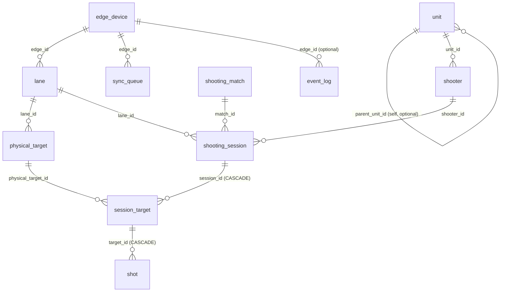

# Database schema — Edge & Server

This describes the SQLite database used by both the edge simulators
(`edge/edge.py` and `edge_qt/`) and the server (`server/server.py`). All
three programs share **one schema file**, [`schema.sql`](schema.sql), but
use it to create two structurally-identical yet functionally very
different kinds of database file. Understanding that distinction is the
key to understanding how data moves through the whole system.

## 1. Two databases, one schema

| | Edge (`edge<N>.db`) | Server (`server/server.db`) |
|---|---|---|
| **Where** | Next to `edge.py` / `edge_qt.exe`, one file per lane (`edge1.db`, `edge2.db`, ...) | One single file, next to `server.py` |
| **Scope** | Only what THAT lane produced: its own unit(s), shooter(s), lane row, physical targets, matches, sessions, targets, shots | Everything from EVERY edge that has ever synced, across every lane |
| **Written by** | The edge program itself, directly, as it simulates shots | Only by `POST /api/sync`, receiving events pushed from edges |
| **Read by** | Nothing outside the edge process (it's a local working copy / outbox) | The viewer, the manager statistics panel, the admin reset endpoint |
| **Row IDs** | Local `INTEGER PRIMARY KEY AUTOINCREMENT` — **meaningless outside that file** | Its own separate local IDs — **not the same numbers as any edge's IDs** |
| **Cross-file identity** | Every row also carries a globally-unique `uuid` column | Same — `uuid` is what actually ties an edge's row to the matching server row |

An edge and the server are never the same database and never share a
connection — a lane's `edge1.db` and the server's `server.db` are two
completely separate SQLite files that happen to have identical `CREATE
TABLE` statements. They only agree with each other because the edge sends
the server copies of its rows (see §4), and the server re-creates/updates
matching rows locally, resolving edge-local integer IDs into its own
server-local integer IDs via the shared `uuid`.

This is also why every edge safely runs its own **independent**
auto-incrementing ID sequence starting at 1 — `edge1.db`'s `shot_id 7` and
`edge2.db`'s `shot_id 7` are unrelated rows in unrelated files; only their
`uuid` columns are ever compared across files.

## 2. Entity-relationship diagram



Reading it: a **unit** (a real-world organization/team) has **shooters**.
An **edge device** owns one or more **lanes** (in practice always exactly
one, per the "one edge process = one lane" convention); each lane has
**physical targets** (the actual target positions/backstops on that lane).
A **shooting match** is the umbrella event; a **shooting session** is one
shooter's turn on one lane within one match. A session has one
**session_target** per physical target it uses, and each session_target
accumulates its **shots** one at a time as they're fired.

## 3. Table reference

### `unit`
A real-world organization/team a shooter belongs to (e.g. a military unit,
a club). Independent of any lane — the same unit's shooters can be
scheduled on different lanes across different sessions (see §5).

| Column | Type | Notes |
|---|---|---|
| `unit_id` | INTEGER PK | Local to this database file only |
| `uuid` | TEXT, unique | Cross-database identity |
| `parent_unit_id` | INTEGER, nullable | Self-reference, for a unit hierarchy (unused by the current edge/viewer logic, but supported by the schema) |
| `unit_code` | TEXT, unique | Natural key — this is what edges and the server match on when merging (e.g. `UNIT-LANE1`, or any `--unit-code`/roster-supplied value) |
| `unit_name` | TEXT | Display name |
| `unit_type`, `status` | TEXT | `status` is `ACTIVE`/`INACTIVE` |

### `shooter`
One person. Always belongs to exactly one unit.

| Column | Type | Notes |
|---|---|---|
| `shooter_id` | INTEGER PK | Local only |
| `uuid` | TEXT, unique | Cross-database identity |
| `unit_id` | INTEGER FK → `unit` | |
| `shooter_code` | TEXT | Natural key together with `unit_id` (`UNIQUE(unit_id, shooter_code)`) — e.g. `S01`, or `S01-02` for the 2nd person in `--people` mode |
| `name` | TEXT | Display name (Vietnamese name pool by default in the simulators) |
| `status` | TEXT | `ACTIVE`/`INACTIVE` |

### `edge_device`
One edge simulator process/installation (one `edge.py` or `edge_qt`
instance = one row here, in its OWN db; the server accumulates one row per
distinct edge it has ever heard from).

| Column | Type | Notes |
|---|---|---|
| `edge_id` | INTEGER PK | Local only |
| `uuid` | TEXT, unique | This edge's own permanent identity, generated once and reused across restarts |
| `edge_code` | TEXT, unique | Natural key, e.g. `EDGE-LANE1` |
| `hostname`, `ip_address`, `software_version` | TEXT | Informational |
| `config_version` | INTEGER | Informational, defaults to 1 |
| `status` | TEXT | `ONLINE`/`OFFLINE`/`ERROR`/`MAINTENANCE` |
| `last_seen` | TEXT | Informational |

### `lane`
A physical shooting lane. `lane_number` is the field the whole system
organizes around (the viewer's lane tabs, the `--lane N` CLI flag, etc).

| Column | Type | Notes |
|---|---|---|
| `lane_id` | INTEGER PK | Local only |
| `uuid` | TEXT, unique | |
| `edge_id` | INTEGER FK → `edge_device` | |
| `lane_number` | INTEGER, **globally unique** | The natural key — this is why two edges must never be given the same `--lane` value, they'd collide on the server |
| `lane_name`, `status`, `description` | TEXT | `status`: `ACTIVE`/`INACTIVE`/`MAINTENANCE`/`ERROR` |

### `physical_target`
One target position/backstop on a lane (a lane usually has 2+, set by
`--targets`).

| Column | Type | Notes |
|---|---|---|
| `physical_target_id` | INTEGER PK | Local only |
| `uuid` | TEXT, unique | |
| `lane_id` | INTEGER FK → `lane` | |
| `target_code` | TEXT | Natural key together with `lane_id` |
| `target_position` | INTEGER | 1-based position on the lane; natural key together with `lane_id` |
| `target_width_mm`, `target_height_mm`, `image_width_px`, `image_height_px`, `calibration_version`, `calibration_data` | | Reserved for real camera/detector calibration; the simulators don't populate these beyond the defaults |
| `status` | TEXT | `ACTIVE`/`INACTIVE`/`CALIBRATION`/`ERROR` |

### `shooting_match`
The umbrella event a session belongs to. Each simulated session currently
creates its own fresh match (`MATCH-L<lane>-<timestamp>`) — there's no
persistent "tournament" concept yet.

| Column | Type | Notes |
|---|---|---|
| `match_id` | INTEGER PK | Local only |
| `uuid` | TEXT, unique | |
| `match_code` | TEXT, unique | Natural key |
| `match_name` | TEXT | |
| `start_time`, `end_time` | TEXT | ISO-8601 |
| `status` | TEXT | `PLANNED`/`READY`/`RUNNING`/`PAUSED`/`COMPLETED`/`CANCELLED` |
| `description` | TEXT | |

### `shooting_session`
One shooter's turn on one lane, within one match. This is the row the
viewer's lane tabs and history dropdown are built around.

| Column | Type | Notes |
|---|---|---|
| `session_id` | INTEGER PK | Local only |
| `uuid` | TEXT, unique | |
| `match_id`, `lane_id`, `shooter_id` | INTEGER FKs | |
| `session_number` | INTEGER, nullable | |
| `start_time`, `end_time` | TEXT | ISO-8601 |
| `status` | TEXT | `WAITING`/`READY`/`RUNNING`/`PAUSED`/`COMPLETED`/`CANCELLED`/`ERROR` |
| `total_score` | REAL | Sum of every `session_target.total_score` under this session; recomputed after every shot and after every manager correction |
| `total_shots` | INTEGER | Sum of shots fired so far across this session's targets — this is the field `shooters_total`/`shooters_on_lane`/`shooters_participated` all filter on (`total_shots > 0`) to count only shooters who actually fired |

### `session_target`
One physical target, as used within one session — this is the row the
viewer's target cards and the before/after compare panel are built around.

| Column | Type | Notes |
|---|---|---|
| `target_id` | INTEGER PK | Local only — this is the `target_id` used in `GET /api/targets/{id}/detail` |
| `uuid` | TEXT, unique | |
| `session_id` | INTEGER FK → `shooting_session`, **ON DELETE CASCADE** | |
| `physical_target_id` | INTEGER FK → `physical_target` | |
| `target_number` | INTEGER | 1-based position within this session; natural key together with `session_id` |
| `start_time`, `end_time` | TEXT | ISO-8601 |
| `status` | TEXT | `WAITING`/`ACTIVE`/`PAUSED`/`COMPLETED`/`CANCELLED`/`ERROR` |
| `total_score` | REAL | Sum of this target's own shots' scores |
| `total_shots` | INTEGER | How many shots have landed on this target so far |
| `start_image_path` | TEXT | Path (under `/images/`) to the blank "before any shot" image, rendered once when the session_target is created — this is the "start" half of the compare panel |

### `shot`
One recorded impact.

| Column | Type | Notes |
|---|---|---|
| `shot_id` | INTEGER PK | Local only |
| `uuid` | TEXT, unique | |
| `target_id` | INTEGER FK → `session_target`, **ON DELETE CASCADE** | |
| `shot_number` | INTEGER | 1-based order within this target; natural key together with `target_id` |
| `shot_timestamp` | TEXT, NOT NULL | ISO-8601 |
| `x_pixel`, `y_pixel` | REAL | Impact position in the rendered image's pixel space |
| `x_mm`, `y_mm` | REAL | Impact position in millimeters from target center — this is the coordinate space the manager-correction click math works in |
| `distance_mm` | REAL | `sqrt(x_mm² + y_mm²)` |
| `score` | REAL | `max(0, round(10 - distance_mm/25, 1))` — identical formula in edge.py, edge_qt, and the server's correction endpoint |
| `confidence` | REAL, 0-1 | Reserved for a real detector's confidence value; simulators don't populate it meaningfully |
| `detection_method` | TEXT | Reserved |
| `image_path` | TEXT | Path to the CUMULATIVE target-face image after this shot (every hit so far, not just this one) — this is what the compare panel shows as the "current"/"finished" image (the LAST shot's `image_path`) |
| `frame_id` | TEXT | Reserved |
| `corrected` | INTEGER (0/1) | Set to 1 by a manager's correction (`POST /api/shots/{id}/correct`) — never touched by the simulators themselves |

### `sync_queue` (edge-side outbox — largely empty on the server)
Every edge's local, durable "things I still need to tell the server"
queue. An edge appends a row here every time it creates or updates
anything; `sync()` reads pending rows, POSTs them to `/api/sync`, and
marks them `SENT` on success (or leaves them `PENDING`/bumps
`retry_count` on failure — nothing is lost if the network is down).

| Column | Type | Notes |
|---|---|---|
| `sync_id` | INTEGER PK | Local only |
| `uuid` | TEXT, unique | |
| `edge_id` | INTEGER FK → `edge_device` | Always this edge's own row |
| `event_type` | TEXT | `CREATE` or `UPDATE` |
| `entity_type` | TEXT | Which table this event describes (`unit`, `shooter`, `lane`, `physical_target`, `shooting_match`, `shooting_session`, `session_target`, `shot`) |
| `entity_id`, `entity_uuid` | | The local row this event is about |
| `payload` | TEXT (JSON) | The actual data sent to the server — field names/shapes are what `server.py`'s `_sync_*` handlers expect |
| `status` | TEXT | `PENDING`/`SENDING`/`SENT`/`FAILED` |
| `retry_count`, `last_error` | | |

The server also has this table (same schema), but never writes to it —
it's purely an edge-side mechanism. It stays empty in `server.db`.

### `event_log`
A generic audit trail. Currently only used for two things: (1) the
simulators can log arbitrary informational events (not exercised much in
practice), and (2) the server logs every manager correction here
(`event_type='CORRECTION'`, with the shot's old and new `x_mm`/`y_mm`/
`score` in `payload`).

| Column | Type | Notes |
|---|---|---|
| `event_id` | INTEGER PK | Local only |
| `uuid` | TEXT, unique | |
| `edge_id` | INTEGER, nullable FK → `edge_device`, **ON DELETE SET NULL** | Null for server-originated events like corrections |
| `event_type`, `entity_type`, `entity_id`, `entity_uuid` | | What happened, to what |
| `event_time` | TEXT | ISO-8601 |
| `payload` | TEXT (JSON), nullable | |
| `severity` | TEXT | `DEBUG`/`INFO`/`WARNING`/`ERROR`/`CRITICAL` |

## 4. How an edge's data becomes the server's data

1. As an edge simulates shots, it writes directly into its own tables
   (`unit`, `shooter`, `lane`, `physical_target`, `shooting_match`,
   `shooting_session`, `session_target`, `shot`) AND appends a matching
   `sync_queue` row for each insert/update, in the same local transaction.
2. After every shot (and at session completion), the edge calls
   `POST /api/sync` with its pending `sync_queue` rows' payloads.
3. `server.py` processes each event with a per-entity handler
   (`_sync_unit`, `_sync_shooter`, `_sync_lane`, ...). Every handler
   **upserts on a natural key**, not on the edge's local integer ID:
   - `unit` → `unit_code`
   - `shooter` → `(unit_id, shooter_code)`
   - `lane` → `lane_number`
   - `physical_target` → `(lane_id, target_position)`
   - `edge_device` → `edge_code`

   This is done with SQLite's `INSERT ... ON CONFLICT(...) DO UPDATE SET
   uuid=excluded.uuid, ...` — so if the server has never seen this
   `unit_code` before, it creates a fresh row; if it has (even from a
   totally different edge/lane), it just updates that existing row and
   keeps its own server-local `unit_id`. `entity_uuid` in later events is
   what lets `_lookup_id()` resolve "which server-local row does this
   edge's `shooter_id 4` actually correspond to."
4. Because `shooter` upserts on `(unit_id, shooter_code)` — never on
   which lane produced the event — the same real-world shooter is
   correctly merged into ONE server-side row even if they're scheduled
   across multiple lanes over time. This is also why edges must set
   `unit_code`/`unit_name` independently of `--lane` (via
   `--unit-code`/`--unit-name` or a `--roster` file) rather than letting
   it default to a lane-derived value, whenever a real unit's shooters
   really do span lanes.
5. `session_target` CREATE events additionally carry `start_image_b64`;
   the server decodes and saves it under `images/`, recording the path
   in `start_image_path`. Every `shot` event's `image_path` is handled
   the same way.

## 5. Images are files, not database rows

`start_image_path` and `shot.image_path` are just relative URL paths like
`/images/start_<uuid>.png` — the actual PNG bytes live as ordinary files
under `images/` (`edge<N>/images_lane<N>/` locally on each edge,
`server/images/` on the server), served by a static file mount. Deleting a
row does not delete its image file automatically (except via the admin
reset endpoint, which deletes both explicitly — see §7).

## 6. Schema migrations

`schema.sql` uses `CREATE TABLE IF NOT EXISTS`, which only creates a table
if it's missing — it never adds a column to a table that already exists.
Two columns (`session_target.start_image_path`, `shot.corrected`) were
added after some deployments already had populated databases, so all
three programs (`server.py`'s `init()`, `edge.py`'s `Edge.init()`,
`EdgeDatabase::open()` in edge_qt) also run:

```sql
ALTER TABLE session_target ADD COLUMN start_image_path TEXT;
ALTER TABLE shot ADD COLUMN corrected INTEGER NOT NULL DEFAULT 0;
```

wrapped so a "duplicate column name" error (meaning an earlier run
already applied it) is silently ignored. Any future additive schema
change should follow the same pattern — add the column to `schema.sql`
for brand-new databases, AND add an idempotent `ALTER TABLE` in all three
`init()`/`open()` functions for already-existing ones.

## 7. Wiping data for testing

- **One edge's local data**: delete `edge<N>.db` + `images_lane<N>/`
  (or run `edge.py --lane N --reset` / `edge_qt --lane N --reset` / the
  GUI's "Xóa dữ liệu" button, which do exactly that).
- **All server data**: `POST /api/admin/reset` (manager token +
  `{"confirm":"DELETE ALL"}`) empties every table in `server.db` and
  deletes every file under `server/images/`.

These are independent of each other — resetting an edge does not touch
the server's copy of that lane's old data, and vice versa. See
`README.md` section 8 for the full how-to.
